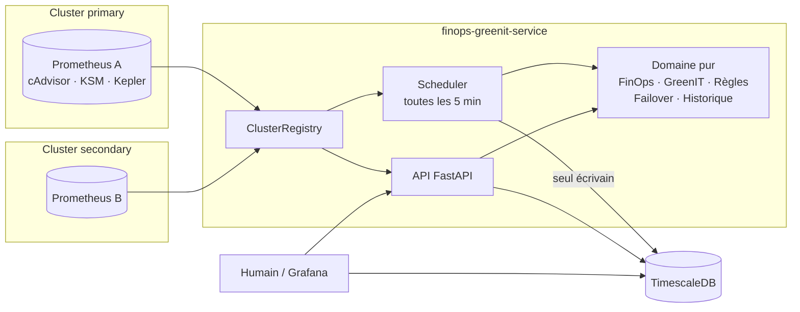

# PROJECT_GUIDE — finops-greenit-service (V1)

> Guide pédagogique du dépôt `checkmata/finops-greenit-service`. Base analysée : commit `c34f8b7` (MVP, 9 septembre 2026), puis évolution **V1** sur la branche `feature/v1-multicluster-workloads`.
>
> Autres documents : [README docs](README.md) — [ARCHITECTURE](ARCHITECTURE.md) · [DATA_FLOW](DATA_FLOW.md) · [FINOPS](FINOPS.md) · [GREENIT](GREENIT.md) · [MULTICLUSTER](MULTICLUSTER.md) · [FAILOVER](FAILOVER.md) · [WORKLOADS](WORKLOADS.md) · [LIMITATIONS](LIMITATIONS.md) · [ROADMAP](ROADMAP.md) · [INTERVIEW_GUIDE](INTERVIEW_GUIDE.md)

## Légende utilisée partout

- 🟢 **Confirmé par le code** — observable dans le dépôt, et le plus souvent exécuté (tests ou démo).
- 🟡 **Déduction / fourni mais non exécuté** — raisonnable, mais pas vérifié par une exécution.
- 🔴 **À confirmer avec Marouane** — nécessite ton expérience réelle ou une information absente du dépôt.

## Sommaire

1. [Vue d'ensemble](#1-vue-densemble) · 2. [Architecture](#2-architecture) · 3. [Technologies](#3-technologies) · 4. [Structure](#4-structure-du-repository) · 5. [Fonctions/classes importantes](#5-les-fonctionsclasses-importantes) · 6. [Flux principal](#6-flux-principal) · 7. [Explication débutant](#7-si-je-devais-expliquer-le-projet-à-quelquun-qui-ne-connaît-pas-la-technique) · 8. [FinOps](#8-finops-expliqué-avec-ce-projet) · 9. [GreenIT](#9-greenit-expliqué-avec-ce-projet) · 10. [Exemple](#10-exemple-concret-de-fonctionnement) · 11. [Installation](#11-installation-et-exécution) · 12. [Tests](#12-tests) · 13. [Concepts entretien](#13-ce-que-je-dois-comprendre-pour-un-entretien-technique) · 14. [Questions](#14-questions-quun-recruteur-pourrait-poser) · 15. [Pitch RH](#15-pitch-rh--30-secondes) · 16. [Pitch technique](#16-explication-technique--1-à-2-minutes) · 17. [Glossaire](#17-glossaire) · 18. [Faits vs hypothèses](#18-faits-vs-hypothèses--récapitulatif)

---

## 1. Vue d'ensemble

### C'est quoi ce projet ?

🟢 Un **micro-service Python (FastAPI)** qui observe un ou **plusieurs clusters Kubernetes/OpenShift**. Pour chaque cluster, namespace (espace d'une équipe) et workload (application, identifiée par le label `app`), il répond à trois questions :

1. **FinOps** : combien coûte ce qui est *réservé*, ce qui est *utilisé*, et combien on *gaspille* (CPU, mémoire, stockage) ?
2. **GreenIT** : combien d'énergie cela consomme, combien de CO₂ cela représente, et **ce chiffre est-il mesuré ou estimé** ?
3. **Continuité** (V1) : si un cluster tombe, quel cluster **devrait** servir chaque workload ?

Il produit des **recommandations** (« réduire la request CPU de txn-processor de 3 à 0,72 cœur ») qu'un humain approuve ou rejette. Il **ne modifie jamais** les clusters : ni scaling, ni déplacement de trafic.

### Pourquoi il existe ? Quel problème il résout ?

🟢 Dans Kubernetes, chaque application **réserve** (*requests*) du CPU et de la mémoire, qu'elle s'en serve ou non. Par prudence, les équipes réservent large, ce qui donne de la **capacité payée mais inutilisée** et de l'**énergie consommée pour rien**. Le service mesure l'écart, le chiffre en dollars et en CO₂, et propose un redimensionnement **sûr** : il attend assez d'historique et n'invente jamais une valeur manquante.

🔴 Le dépôt **ne mentionne jamais Eurafric Information** ni le contexte métier réel (périmètre, clusters, volumétrie).
🟡 `AGENTS.md` parlait d'un « 1-month MVP » et d'un « oral exam » : le MVP ressemble à un prototype réalisé en environ un mois (stage ou projet évalué). V1 est une évolution de ce MVP.

### Lien FinOps / GreenIT

Les deux partent du **même écart** entre réservé et utilisé : × tarif = dollars (FinOps) ; énergie mesurée × PUE × intensité carbone = CO₂ (GreenIT). Réduire le gaspillage améliore les deux.

---

## 2. Architecture

Architecture **hexagonale** : le cœur de calcul (domaine) est isolé de Prometheus, de la base et de HTTP. Il y a **un Prometheus par cluster** (comme sur OpenShift) et un adaptateur par cluster. Détails : [ARCHITECTURE](ARCHITECTURE.md).



| Composant | Responsabilité |
|---|---|
| **Racine de composition** (`app/composition.py`) | crée une fois les adaptateurs (un Prometheus par cluster, une base) |
| **Registre** (`app/cluster_registry.py`) | port de chaque cluster, déclarations opérateur, dernière liste de workloads fiable |
| **Scheduler** (`app/scheduler/snapshot_job.py`) | cycle multicluster : collecte → calculs → recommandations → historique (**seul écrivain**) |
| **Domaine** (`app/domain/`) | formules FinOps/GreenIT, règles, cycle de vie, décision de failover, agrégation d'historique |
| **Routers FastAPI** | lecture temps réel, historique, clusters, décisions humaines, santé |
| **Adaptateurs** | PromQL (httpx) et SQL (SQLAlchemy async) |

---

## 3. Technologies

| Technologie | Rôle dans le projet | Pourquoi ici |
|---|---|---|
| **Python 3.12 / FastAPI / Uvicorn** | le service et son API | asynchrone (scheduler et API dans la même boucle), `Depends()` pour injecter les ports et les remplacer dans les tests, Swagger automatique |
| **Pydantic / pydantic-settings** | schémas de réponse, configuration typée | uniquement aux frontières, jamais dans le domaine |
| **httpx** | client de l'API Prometheus | asynchrone, pool de connexions, timeouts ; **une instance par cluster** (V1) |
| **Prometheus + PromQL** | source de toutes les mesures | déjà fourni par OpenShift ; en démo : 2 vrais Prometheus 2.53.2 |
| **Kepler** | énergie par conteneur/pod (eBPF) | seule source d'énergie ; sa provenance est tracée |
| **PostgreSQL + TimescaleDB** | recommandations + 2 hypertables d'historique | relationnel et séries temporelles dans une seule base, rétention automatique |
| **SQLAlchemy async + asyncpg** (+ aiosqlite) | ORM | ne pas bloquer la boucle ; SQLite pour les tests et la démo locale |
| **PyYAML** | fichier de clusters (`config/clusters.*.yaml`) | configuration multicluster lisible (dépendance déjà présente, enfin utilisée) |
| **prometheus_client** | `/metrics` du service, simulateur, workloads | observer le scheduler ; produire des séries réalistes |
| **python-json-logger** | logs JSON (`LOG_FORMAT=json`) | dépendance déjà présente, enfin branchée |
| **Docker / Compose** | images ; pile locale (DB, 2 simulateurs, 2 Prometheus, API, Grafana) | reproduire sans cluster (🟡 compose non exécuté en V1) |
| **kind + kustomize + Helm** | 2 vrais clusters locaux, overlays primary/secondary, kube-prometheus-stack, Kepler | chemin « réel » (🟡 script non exécuté ; overlays construits et validés) |
| **Online Boutique** | workload e-commerce réaliste (Apache-2.0) | vraie appli microservices avec générateur de charge |
| **Grafana** | 4 dashboards générés par script | visualiser infra, FinOps, GreenIT, recommandations (🟡 non affichés) |
| **pytest (+ asyncio, cov)** | 378 tests, couverture 92 % de `app/` | domaine sans mock, adaptateurs avec faux transport, intégration SQLite |
| **GitHub Actions, kubeconform** | CI : tests + couverture, validation des manifestes, builds | 🟡 workflow non exécuté sur GitHub ; étapes rejouées en local |

Non utilisés, **volontairement** : OpenTelemetry (pas de besoin en V1), Celery/Redis (le scheduler asyncio suffit pour 1 réplique), ML et LLM (V3/V4).

---

## 4. Structure du repository

```text
finops-greenit-service/
├── README.md · AGENTS.md (règles d'architecture, mises à jour V1)
├── app/
│   ├── config.py · cluster_config.py · cluster_registry.py · composition.py
│   ├── logging_config.py · observability.py · __main__.py
│   ├── domain/          finops_engine · greenit_engine · recommendation_engine
│   │                    recommendation_lifecycle · failover · history · namespace_selection · models/
│   ├── ports/           metrics_port.py · storage_port.py
│   ├── adapters/inbound/api/   main · dependencies · 6 routers · schemas/
│   ├── adapters/outbound/      prometheus_adapter · timescale_adapter · db/ (ORM + migrations 001, 002)
│   └── scheduler/snapshot_job.py
├── config/              clusters.local.yaml · clusters.compose.yaml · clusters.kind.yaml
├── exporter/            simulateur de clusters (profiles, simulator, fake_metrics)
├── workloads/           banking/ · trading/ (applis + k8s) · ecommerce/ (Online Boutique k8s)
├── prometheus/          prometheus-primary.yml · prometheus-secondary.yml
├── grafana/             provisioning/ · dashboards/ (générés)
├── manifests/           OpenShift : service, TimescaleDB, Kepler, *secret.example.yaml
├── scripts/             run_local_demo.sh · simulate_failover.sh · load_test_data.py
│                        generate_grafana_dashboards.py · k8s/ (kind)
├── tests/               unit/ · integration/ · test_*.py (MVP) · helpers_v1.py
├── .github/workflows/ci.yml
└── docs/
```

| Dossier | Il sert à… |
|---|---|
| `app/domain/` | toute la logique métier, testable sans rien d'extérieur |
| `app/ports/` | dire **ce dont** le domaine a besoin (mesures, stockage) sans dire **comment** |
| `app/adapters/` | parler HTTP (entrée), PromQL et SQL (sortie) |
| `config/` | la liste des clusters observés |
| `exporter/` | **simuler** deux clusters sur un laptop |
| `workloads/` | les applications métier qui génèrent une vraie charge sur Kubernetes |
| `manifests/` | déployer le service sur OpenShift |
| `scripts/` | démo, failover, données de test, dashboards, kind |

---

## 5. Les fonctions/classes importantes

| Fichier | Classe / fonction | Rôle |
|---|---|---|
| `app/composition.py` | `build_container()` | crée les adaptateurs une seule fois (un par cluster) |
| `app/cluster_config.py` | `load_clusters()`, `parse_clusters()` | lit et valide la liste des clusters |
| `app/scheduler/snapshot_job.py` | `run_multicluster_cycle()` | boucle sur les clusters (saute les injoignables) |
| idem | `resolve_namespaces()` | liste explicite ou découverte + filtres |
| idem | `_process_namespace()` | **le pipeline** : collecte → calculs → recos → historique |
| `app/adapters/outbound/prometheus_adapter.py` | `get_pod_metrics()` | usage (moyenne de taux 5 min sur 30 j), heures d'historique, requests, équipe majoritaire |
| idem | `get_workload_metrics()` | détail par workload (jointure `kube_pod_labels`), reste `_unattributed` |
| idem | `get_energy()` | énergie + provenance : conteneur → pod → nœud × part CPU → indisponible |
| idem | `get_deployment_availability()`, `ping()`, `list_namespaces()` | entrées du failover, santé, découverte |
| `app/domain/finops_engine.py` | `calculate_requested_cost()` / `calculate_monthly_cost()` | coûts CPU + mémoire + stockage |
| idem | `summarize_waste()` | gaspillage par composant (brut) |
| idem | `rightsizing_savings_usd()` | économie = réservation libérée (≤ gaspillage) |
| `app/domain/greenit_engine.py` | `carbon_footprint_from_measurement()` | kWh → CO₂, ou `None` si inattribuable |
| `app/domain/recommendation_engine.py` | `generate_all_recommendations()` | règles par workload, historique minimal, idle, provenance |
| `app/domain/recommendation_lifecycle.py` | `can_transition()`, `decide_upsert()` | transitions humaines ; dédoublonnage |
| `app/domain/failover.py` | `plan_failover()` | quel cluster devrait servir chaque workload, et pourquoi |
| `app/domain/history.py` | `aggregate()` | séries temporelles correctes (moyenne dans une série, somme entre séries) |
| `app/adapters/outbound/timescale_adapter.py` | `upsert_recommendation()`, `mark_obsolete()` | pas de doublons ; clôture de ce qui est résolu |

---

## 6. Flux principal

```text
1. Démarrage : lifespan() → build_container() → scheduler lancé en tâche de fond
2. Toutes les 5 min : run_multicluster_cycle() → pour chaque cluster joignable → namespaces sélectionnés
3. Collecte : get_pod_metrics · get_workload_metrics · get_storage_metrics · get_energy · check_data_quality
4. Calculs : coût réservé / utilisé → gaspillage par composant → CO₂ (si énergie attribuable)
5. Règles : par workload → réduire / augmenter / différer (historique) ; ENERGY_WASTE seulement si idle mesuré
6. Stockage : upsert (dédoublonné) → mark_obsolete → snapshots workload + namespace
7. Consultation : API (temps réel, historique, clusters) et Grafana ; décision humaine via PATCH
```

Détail ligne à ligne : [DATA_FLOW](DATA_FLOW.md) · séquences : [diagrams/main-flow.md](diagrams/main-flow.md).

---

## 7. Si je devais expliquer le projet à quelqu'un qui ne connaît pas la technique

> Imagine une entreprise qui loue des bureaux dans **deux immeubles** : un principal et un de secours. Chaque équipe **réserve** des salles « au cas où ».
>
> Le projet est un **gestionnaire d'immeubles** qui :
> - compte, dans chaque immeuble, les salles réservées et les salles vraiment utilisées, et chiffre la différence en **argent perdu** ;
> - lit les **compteurs électriques** et en déduit le **CO₂**. Quand une salle n'a pas son propre compteur, il fait une estimation et **le dit** ;
> - attend d'avoir observé une équipe assez longtemps avant de lui conseiller de rendre des salles (une équipe qui vient d'arriver n'est pas « inactive ») ;
> - laisse des **conseils** qu'un responsable accepte ou refuse, sans jamais les répéter en boucle ;
> - si l'immeuble principal ferme, il indique **quelles équipes peuvent aller dans l'immeuble de secours**, et lesquelles n'y ont pas de place. Il ne déménage personne lui-même.

---

## 8. FinOps expliqué avec ce projet

**FinOps** : rendre les coûts d'infrastructure **visibles**, **attribués** à ceux qui les génèrent, puis **optimisés**, en faisant travailler ensemble technique et finance (*Informer → Optimiser → Opérer*).

| Étape | Dans ce projet (V1) |
|---|---|
| Informer | coût réservé / utilisé par cluster, namespace, **workload**, et par ressource (CPU, mémoire, stockage) |
| Attribuer | labels `team`, `cost-center`, `environment` conservés jusque dans les recommandations |
| Optimiser | right-sizing avec marge (+20 %), économies **bornées** par le gaspillage, historique minimal |
| Opérer | historique (coût, gaspillage, économies) ; cycle de vie humain des recommandations |

Formules, corrections et statuts du stockage : [FINOPS](FINOPS.md). Points clés V1 :
- l'économie = réservation libérée, donc la somme des économies est toujours ≤ au gaspillage (le MVP comptait deux fois) ;
- le CPU est une **moyenne de taux sur 5 min**, car `rate(x[30d])` faisait paraître inactif tout workload de moins de 30 jours ;
- un stockage non mesurable est « unavailable », **pas** gratuit.

🔴 Les tarifs (0,03 $/vCPU·h, 0,004 $/Go·h, 0,10 $/Go·mois) sont des constantes dont l'origine reste à documenter.

---

## 9. GreenIT expliqué avec ce projet

**GreenIT** : réduire l'impact environnemental du numérique, en commençant par le **mesurer honnêtement**.

**Ce que le code fait réellement** 🟢 :
- énergie Kepler sur 24 h, avec sa **provenance** : `container` / `pod` (mesurée), `node_cpu_share` (estimée), `unavailable` ;
- CO₂ = kWh × PUE (1,4) × intensité (475 gCO₂/kWh) / 1000 ;
- énergie idle uniquement si Kepler la sépare ; sinon `null` et **aucune** alerte `ENERGY_WASTE` ;
- une recommandation fondée sur une estimation le dit (`estimation_method`).

**Le contexte métier** 🟡/🔴 : reporting RSE, bilan carbone, consolidation des nœuds. L'usage réel chez Eurafric est à confirmer, tout comme la source du PUE et de l'intensité.

Détails : [GREENIT](GREENIT.md).

---

## 10. Exemple concret de fonctionnement

⚠️ **Valeurs illustratives** (namespace fictif `banking`). Les résultats ont été **calculés en exécutant le moteur V1** avec ces entrées et les tarifs par défaut.

```text
Namespace banking (72 h d'historique) : 2 workloads + un PVC de 20 Go dont 6 Go utilisés
  txn-processor : request 3 cœurs / 2 Go, utilise 0,6 cœur / 0,9 Go
  fraud-scorer  : request 1 cœur  / 1 Go, utilise 0,2 cœur / 0,5 Go
Kepler (niveau conteneur, avec séparation idle) : 5 kWh sur 24 h dont 1,8 kWh idle
        ↓
Coût réservé / mois  : CPU 86,40 + mémoire 8,64 + stockage 2,00 = 97,04 $
Coût utilisé / mois  : CPU 17,28 + mémoire 4,03 + stockage 0,60 = 21,91 $
Gaspillage           : CPU 69,12 + mémoire 4,61 + stockage 1,40 = 75,13 $ (77 % → CRITICAL)
        ↓
Recommandations :
  [CRITICAL] txn-processor CPU    3,0 → 0,72 cœur   économie 49,25 $/mois
  [CRITICAL] txn-processor mémoire 2,0 → 1,1 Go     économie  2,65 $/mois
  [CRITICAL] fraud-scorer  CPU    1,0 → 0,24 cœur   économie 16,42 $/mois
  [WARNING]  énergie idle = 36 % (1,8 / 5 kWh)      CO₂ évitable ≈ 1,20 kg
  [INFO]     empreinte : 3,33 kgCO₂ pour 5 kWh
  Σ économies = 68,31 $ ≤ gaspillage 75,13 $  ✔ (invariant V1)
        ↓
Si l'énergie venait du repli « nœud × part CPU », le message INFO se terminerait par
« [estimated: node-level fallback] ».
Si le workload n'avait que 2 h d'historique : pas de recommandation de réduction,
mais une INFO « Right-sizing deferred ».
```

---

## 11. Installation et exécution

### Prérequis
Python 3.12. Optionnels : un binaire Prometheus (démo sans Docker), Docker + Compose (pile complète), kind + kubectl + Helm (vrais clusters).

### Installation et tests

```bash
git clone https://github.com/checkmata/finops-greenit-service.git
cd finops-greenit-service
python3.12 -m venv .venv && source .venv/bin/activate
pip install -r requirements-dev.txt          # inclut aiosqlite depuis V1
pytest -q                                    # 378 tests
```

### Variables d'environnement (principales)

| Variable | Défaut | Rôle |
|---|---|---|
| `CLUSTERS_CONFIG_FILE` | *(vide)* | fichier YAML des clusters ; vide = un seul cluster (`CLUSTER_NAME`, `PROMETHEUS_URL`) |
| `DATABASE_URL` | `postgresql://finops@localhost:5432/finops_greenit` | base (mot de passe fourni via `.env` ou un Secret) |
| `SCHEDULER_INTERVAL_SECONDS` | 300 | période du cycle |
| `SCHEDULER_NAMESPACES` | *(vide)* | liste explicite ; vide = découverte |
| `NAMESPACE_INCLUDE_REGEX` / `NAMESPACE_EXCLUDE_REGEX` | `.*` / `^(kube-.*\|openshift.*\|kepler)$` | filtres |
| `WORKLOAD_LABEL` | `app` | label de pod qui définit un workload |
| `MIN_OBSERVATION_HOURS` | 24 | historique requis avant tout right-sizing (168 conseillé en prod) |
| `PUE_CONSTANT`, `GRID_CARBON_INTENSITY_GCO2_PER_KWH`, `COST_PER_*` | 1,4 / 475 / tarifs | constantes métier |
| `LOG_LEVEL`, `LOG_FORMAT` | INFO / json | journalisation |

`.env` est réservé au **développement** (il est ignoré par git). En Kubernetes/OpenShift : Secret créé hors de Git (`manifests/*secret.example.yaml`) ou gestionnaire de secrets.

### Lancer

```bash
# A. Démo sans Docker : 2 clusters simulés + 2 vrais Prometheus + API (SQLite)   🟢 exécutée en V1
PROMETHEUS_BIN=/chemin/prometheus scripts/run_local_demo.sh
scripts/simulate_failover.sh                  # dans un 2e terminal

# B. Pile complète (TimescaleDB, Grafana)                                       🟡 non exécutée en V1
cp .env.example .env && docker compose up -d --build

# C. Deux vrais clusters kind                                                   🟡 non exécuté en V1
scripts/k8s/kind-up.sh

# Données de démonstration (synthétiques)
python -m scripts.load_test_data --database-url sqlite+aiosqlite:///.demo/seed.db
```

---

## 12. Tests

| Dossier / fichier | Ce qui est testé |
|---|---|
| `tests/test_*.py`, `tests/unit/test_*_unit.py` | tests du MVP (moteurs, adaptateurs), **tous conservés** |
| `tests/unit/test_v1_finops.py` | gaspillage par composant, **invariant Σ économies ≤ gaspillage** (80 combinaisons), stockage, historique minimal, portée workload |
| `tests/unit/test_v1_greenit.py` | idle inconnu, provenance, pas de CO₂ inventé |
| `tests/unit/test_v1_lifecycle_failover.py` | transitions, dédoublonnage, sélection des namespaces, 8 scénarios de failover |
| `tests/unit/test_v1_history_config.py` | agrégation temporelle, fichiers de clusters |
| `tests/unit/test_v1_simulator.py`, `test_v1_workloads.py` | cohérence du simulateur ; logique métier banking et trading |
| `tests/integration/test_v1_prometheus_adapter.py` | hiérarchie énergie, jointure workload, filtre cAdvisor, CPU moyenné, disponibilité |
| `tests/integration/test_v1_storage_scheduler.py` | cycle multicluster **de bout en bout** (ports en mémoire → vrai adaptateur SQLite), upsert, obsolete |
| `tests/integration/test_v1_api.py` | clusters/failover, `?cluster=`, 409, health dégradé, historique, `/metrics` |

```bash
pytest -q
pytest --cov=app --cov-report=term-missing   # 92 % sur app/ (MVP : 88 %)
```

Non couvert par les tests automatisés : vrai PostgreSQL/TimescaleDB, Grafana, Kubernetes. La chaîne Prometheus réelle a été vérifiée par la démo locale (voir [MULTICLUSTER §5](MULTICLUSTER.md#5-validation-effectuée-en-v1)).

---

## 13. Ce que je dois comprendre pour un entretien technique

| Concept | Définition simple | Dans CE projet |
|---|---|---|
| Architecture hexagonale | le métier au centre, la technique autour, reliés par des interfaces | `domain/` pur, `ports/`, `adapters/` ; racine de composition |
| Injection de dépendances | on donne à un composant ce dont il a besoin | ports injectés (`Depends`), tarifs/PUE passés en paramètres |
| Fonction pure | mêmes entrées → même sortie | tous les calculs et la décision de failover → tests sans mock |
| Multicluster | plusieurs clusters indépendants | un Prometheus et un adaptateur par cluster ; Kubernetes orchestre *dans* un cluster, ACM/GitOps gère la *flotte* |
| Failover / fail-back | basculer vers un site de secours / revenir | **décision** calculée et expliquée ; l'exécution relève de GitOps/ACM |
| Requests / right-sizing | ressources réservées / ajuster à l'usage | réduire à usage +20 %, augmenter à usage +25 %, pas avant l'historique minimal |
| PromQL `rate` vs moyenne de `rate` | taux sur une fenêtre / moyenne de taux courts | `rate(x[30d])` sous-estime les séries jeunes → `avg_over_time(rate[5m])[30d:5m]` |
| cAdvisor / kube-state-metrics | usage réel / état déclaré (requests, labels, réplicas) | usage, requests, workloads, disponibilité |
| Kepler / eBPF | énergie par conteneur à partir du noyau | provenance tracée ; repli nœud × part CPU = estimation |
| Qualité des données | savoir quand on ne sait pas | `None` / `unavailable`, jamais 0 inventé ; recommandations DATA_QUALITY |
| Idempotence / dédoublonnage | refaire une opération sans effet de bord | fingerprint des recommandations ; seed rejouable |
| Base de séries temporelles | stocker des mesures horodatées | 2 hypertables, rétention 7 jours |
| Human-in-the-loop | l'humain valide avant d'agir | statuts pending → approved → executed/failed, transitions validées (409) |
| Probes liveness / readiness | « le processus vit » / « il peut servir » | `/health/live` vs `/health` (degraded si un seul cluster manque) |
| Simulation vs réel | démontrer sans prétendre | simulateur explicitement étiqueté ; kind comme chemin réel |

---

## 14. Questions qu'un recruteur pourrait poser

### 1. Pourquoi ce projet ?
Les équipes réservent plus de CPU et de mémoire qu'elles n'en utilisent ; cela coûte de l'argent et de l'énergie. Le projet rend ce gaspillage visible par cluster, namespace et application, en dollars et en CO₂, et propose des corrections. 🔴 Le déclencheur chez Eurafric est à compléter.

### 2. Quel problème avez-vous résolu ?
Le manque de visibilité **fiable** : combien coûte chaque application, combien elle gaspille, combien elle émet, et avec quelle précision. En V1, on a ajouté le multicluster et la décision de secours.

### 3. Quel était votre rôle ?
> **À compléter avec le rôle réellement effectué par Marouane.**

🟢 Les 13 commits du MVP sont signés « essoufi ». L'évolution V1 a été réalisée avec un assistant de code (session de travail documentée ici). 🔴 À clarifier avant l'entretien.

### 4. Pourquoi FastAPI ?
Asynchrone (appels réseau vers plusieurs Prometheus et la base, scheduler dans la même boucle), injection de dépendances qui rend les tests simples, documentation Swagger automatique.

### 5. Pourquoi TimescaleDB ?
Une seule base PostgreSQL pour des données relationnelles (recommandations avec cycle de vie) et temporelles (historique avec rétention automatique), lisible nativement par Grafana.

### 6. Comment gérez-vous plusieurs clusters ?
Chaque cluster garde son propre Prometheus (c'est le modèle d'OpenShift). Le service a un adaptateur par cluster, déclaré dans un fichier YAML. Chaque chiffre et chaque recommandation porte le nom de son cluster. Kubernetes n'orchestre qu'à l'intérieur d'un cluster ; la gestion de flotte (ACM, GitOps) est prévue en V2.

### 7. Comment fonctionne le failover ?
Le service observe chaque cluster (Prometheus joignable, kube-state-metrics en ligne, réplicas disponibles). Il calcule, pour chaque application, le statut nominal, dégradé, basculé ou en panne, avec une justification. Il ne déplace pas le trafic : c'est le rôle de GitOps/ACM et d'un load balancer global. La démonstration a révélé deux cas où des applications disparaissaient du plan ; ils sont corrigés et testés.

### 8. Comment circule une donnée ?
Kepler / cAdvisor / kube-state-metrics → Prometheus du cluster → adaptateur (PromQL → objets Python) → domaine (coûts, CO₂, règles) → base (recommandations dédoublonnées, historique) → API / Grafana → décision humaine.

### 9. Comment calculez-vous le CO₂ ? Est-ce fiable ?
kWh × PUE × intensité / 1000. La fiabilité dépend de la **provenance**, qui est affichée : mesurée (conteneur/pod), estimée (part CPU d'un nœud) ou indisponible. On n'invente jamais une valeur.

### 10. Que se passe-t-il si une donnée manque ?
Elle reste « inconnue » (`null`, `unavailable`) et une recommandation de qualité des données est émise. Un stockage non mesuré n'est pas compté comme gratuit ; un idle non mesuré ne déclenche aucune alerte énergie.

### 11. Comment évitez-vous les mauvaises recommandations ?
Marges de sécurité, **historique minimal** avant tout redimensionnement, économies bornées par le gaspillage réel, dédoublonnage, clôture automatique des recommandations devenues sans objet, et surtout validation humaine.

### 12. Quelle difficulté technique avez-vous rencontrée ?
🔴 À compléter avec ton expérience. Difficultés **observables** dans ce travail (à ne citer que si tu les as vécues) :
- `rate(x[30d])` sous-estimait tout workload jeune ; découvert en faisant tourner la démo contre un vrai Prometheus ;
- les économies CPU et mémoire se chevauchaient (double comptage) ;
- des workloads disparaissaient du plan de failover quand un cluster tombait.

### 13. Comment avez-vous testé ?
378 tests : domaine sans mock, adaptateurs avec faux transport HTTP, cycle multicluster complet sur SQLite, API avec clusters en mémoire. Plus une démo réelle avec deux Prometheus et un script de failover.

### 14. Qu'est-ce qui est simulé ?
En local, les clusters et leur charge sont simulés ; Prometheus et le code du service sont réels. Les vraies applications (banking, trading, Online Boutique) et deux clusters kind sont fournis mais n'ont pas été exécutés pendant le développement. Je fais toujours la distinction.

### 15. Pourquoi des données synthétiques ?
Aucune donnée bancaire réelle ne doit sortir d'une banque. Les générateurs (transactions de type AML, carnet d'ordres) ne servent qu'à produire une charge réaliste et reproductible.

### 16. Et l'IA ?
Pas encore : V3 ajoutera une détection d'anomalies et des prévisions **simples et explicables**, en complément des règles ; V4 ajoutera un agent qui explique et priorise, sans jamais agir seul sur la production.

### 17. Quelles sont les limites ?
Tarifs et facteurs carbone constants, énergie par namespace (pas encore par application), décision de failover sans hystérésis, une seule réplique du service, dashboards non encore affichés. Voir [LIMITATIONS](LIMITATIONS.md).

---

## 15. Pitch RH — 30 secondes

> « J'ai travaillé sur un outil FinOps et Green IT pour des plateformes d'hébergement d'applications. Les équipes réservent souvent beaucoup plus de puissance informatique qu'elles n'en utilisent : c'est de l'argent et de l'énergie perdus. L'outil mesure, application par application et sur plusieurs sites, ce qui est réservé, ce qui est utilisé et l'électricité consommée. Il le traduit en coût et en CO₂, en précisant quand un chiffre est estimé, puis propose des ajustements qu'un responsable valide. Il indique aussi, si un site tombe, quelles applications peuvent être reprises par le site de secours. »

🔴 Adapter « j'ai travaillé » à ta contribution exacte et confirmer le contexte Eurafric.

## 16. Explication technique — 1 à 2 minutes

> « C'est un micro-service Python/FastAPI d'observabilité FinOps et Green IT, en architecture hexagonale, qui observe plusieurs clusters Kubernetes/OpenShift.
>
> **Données** : chaque cluster garde son Prometheus, qui récupère l'usage via cAdvisor, les réservations et labels via kube-state-metrics, et l'énergie via Kepler. Le service a un adaptateur par cluster. L'usage CPU est une moyenne de taux sur 5 minutes et exige un historique minimal ; l'énergie est attribuée au conteneur, au pod, ou estimée par la part CPU du nœud, et cette provenance est conservée.
>
> **Calcul** : un domaine pur calcule le coût réservé et utilisé (CPU, mémoire, stockage), le gaspillage par ressource et le CO₂. Des règles produisent des recommandations par application, avec des économies bornées par le gaspillage réel. Une fonction pure décide du failover : nominal, dégradé, basculé ou en panne, avec une justification.
>
> **Persistance et restitution** : un scheduler, seul écrivain, historise dans TimescaleDB. Les recommandations sont dédoublonnées et clôturées quand elles n'ont plus lieu d'être ; l'humain les approuve via l'API avec des transitions validées. Quatre dashboards Grafana sont générés par script.
>
> **Qualité** : 378 tests, et une démo réelle avec deux Prometheus qui a révélé des bugs corrigés ensuite. Prochaines étapes : ACM/GitOps et historique long (V2), anomalies et prévisions explicables (V3), agent d'explication avec validation humaine (V4). »

---

## 17. Glossaire

```text
FinOps
→ discipline qui rend les coûts d'infrastructure visibles, attribués et optimisés.
→ Dans ce projet : finops_engine.py (coût réservé vs réel, gaspillage) + labels team/cost_center.

GreenIT (numérique responsable)
→ démarche pour réduire l'impact environnemental du numérique, en commençant par le mesurer.
→ Dans ce projet : greenit_engine.py (énergie Kepler → kWh → kg CO₂).

OpenShift
→ plateforme Kubernetes d'entreprise de Red Hat.
→ Dans ce projet : le cluster observé et la plateforme de déploiement (manifests/, Route).

Kubernetes
→ système qui fait tourner et orchestre des conteneurs sur plusieurs serveurs.
→ Dans ce projet : fournit les notions de namespace, pod, requests, DaemonSet, StatefulSet.

Namespace
→ espace logique regroupant les ressources d'une équipe/application.
→ Dans ce projet : unité d'analyse (toutes les routes prennent {namespace}).

Pod / conteneur
→ plus petite unité qui fait tourner une application.
→ Dans ce projet : les métriques sont par conteneur puis additionnées par namespace.

Requests
→ CPU/mémoire réservés par un conteneur.
→ Dans ce projet : base du « coût réservé » (kube_pod_container_resource_requests).

Sur-provisionnement / right-sizing
→ réserver trop / ajuster la réservation à l'usage réel.
→ Dans ce projet : ratio < 0,5 → recommandation de réduction à usage × 1,2.

Throttling / OOMKill
→ ralentissement forcé quand le CPU manque / arrêt brutal quand la mémoire manque.
→ Dans ce projet : ratio > 1,0 → recommandation CRITICAL d'augmentation.

Prometheus
→ base de métriques qui collecte régulièrement des mesures chiffrées.
→ Dans ce projet : unique source de mesures, interrogée par PrometheusMetricsAdapter.

PromQL
→ langage de requête de Prometheus.
→ Dans ce projet : sum(rate(...[30d])), increase(...[24h]), up{job=~"..."}.

cAdvisor
→ composant qui mesure l'usage CPU/mémoire des conteneurs.
→ Dans ce projet : fournit container_cpu_usage_seconds_total et container_memory_working_set_bytes.

kube-state-metrics
→ exporte l'état déclaré des objets Kubernetes (réservations, labels, volumes).
→ Dans ce projet : requests, kube_pod_labels, PVC ; s'il est en panne, pas de recos FinOps.

node-exporter
→ exporte les métriques système des serveurs.
→ Dans ce projet : seulement surveillé via `up` (métriques P1 non utilisées).

Kepler
→ outil open source qui estime l'énergie par conteneur grâce à eBPF.
→ Dans ce projet : énergie par conteneur ou par pod ; sinon repli sur le nœud (estimé).

eBPF
→ technologie pour exécuter de petits programmes d'observation dans le noyau Linux.
→ Dans ce projet : raison pour laquelle Kepler tourne en DaemonSet privilégié.

Joule / kWh
→ unités d'énergie ; 1 kWh = 3 600 000 J.
→ Dans ce projet : joules_to_kwh().

PUE (Power Usage Effectiveness)
→ énergie totale du datacenter / énergie des serveurs (1,0 = parfait).
→ Dans ce projet : constante PUE_CONSTANT = 1.4 (multiplie l'énergie IT).

Intensité carbone du réseau
→ grammes de CO₂ émis pour produire 1 kWh d'électricité (dépend du pays).
→ Dans ce projet : constante GRID_CARBON_INTENSITY_GCO2_PER_KWH = 475.

Chargeback
→ refacturer les coûts à l'équipe qui les génère.
→ Dans ce projet : labels team / cost_center / environment (préparé, partiellement exploité).

TimescaleDB / hypertable / rétention
→ extension PostgreSQL pour séries temporelles / table partitionnée automatiquement par temps / suppression auto des vieilles données.
→ Dans ce projet : metric_snapshots, partitions d'1 jour, rétention 7 jours.

ORM (SQLAlchemy)
→ correspondance entre tables SQL et classes Python.
→ Dans ce projet : RecommendationRecord, MetricSnapshotRecord.

FastAPI / Uvicorn
→ framework web Python asynchrone / serveur qui l'exécute.
→ Dans ce projet : les 4 routers, lancés par uvicorn sur le port 8080.

Pydantic / DTO
→ validation de données / objet dédié au format d'échange.
→ Dans ce projet : schemas/*Response, Settings.

Architecture hexagonale (Ports & Adapters)
→ le métier au centre, relié à l'extérieur par des interfaces.
→ Dans ce projet : domain/ ↔ ports/ ↔ adapters/.

Dataclass frozen
→ classe Python simple et non modifiable.
→ Dans ce projet : tous les objets du domaine (PodMetric, Recommendation…).

Scheduler
→ code exécuté à intervalle régulier.
→ Dans ce projet : snapshot_job.py, cycle multicluster toutes les 300 s, seul à écrire en base.

Probe (liveness/readiness/startup)
→ vérification automatique de santé par OpenShift.
→ Dans ce projet : GET /health.

DaemonSet / StatefulSet / Deployment / Route / ConfigMap / Secret / ServiceMonitor
→ objets Kubernetes/OpenShift : 1 pod par nœud / pod à stockage stable / pods standard / exposition HTTP(S) / configuration / données sensibles / « scrape ce service ».
→ Dans ce projet : Kepler / TimescaleDB / API / exposition de l'API / tarifs et constantes / DATABASE_URL / scrape de Kepler.

MVP
→ version minimale qui fonctionne, pour valider l'idée.
→ Dans ce projet : « 1-month MVP » selon AGENTS.md.

Multicluster / flotte
→ plusieurs clusters Kubernetes indépendants, gérés ensemble.
→ Dans ce projet : un Prometheus et un adaptateur par cluster (config/clusters.*.yaml).

ACM (Advanced Cluster Management) / GitOps / Argo CD
→ outils de gestion de flotte : enregistrer des clusters, y déployer depuis Git, appliquer des politiques.
→ Dans ce projet : prévus en V2 ; pas encore présents.

Primary / secondary (standby)
→ site principal / site de secours qui fait tourner une copie réduite.
→ Dans ce projet : rôle déclaré dans le fichier de clusters ; overlays kustomize distincts.

Failover / fail-back
→ basculer vers le secours / revenir au principal.
→ Dans ce projet : décision calculée par plan_failover(), jamais exécutée par le service.

Workload
→ une application déployée (souvent un Deployment).
→ Dans ce projet : valeur du label de pod `app` (WORKLOAD_LABEL) ; reste « _unattributed ».

Provenance / attribution de l'énergie
→ d'où vient un chiffre et avec quelle précision.
→ Dans ce projet : container | pod (mesuré), node_cpu_share (estimé), unavailable.

Historique minimal (observation)
→ durée de mesure nécessaire avant de conclure.
→ Dans ce projet : MIN_OBSERVATION_HOURS ; en dessous, right-sizing différé.

Fingerprint / dédoublonnage
→ identité stable d'un conseil pour ne pas le répéter.
→ Dans ce projet : cluster|namespace|workload|catégorie|ressource.

Obsolete
→ conseil dont la condition a disparu.
→ Dans ce projet : statut posé par le système seul, jamais via l'API.

kind / kustomize / Helm
→ Kubernetes dans Docker / variantes de manifestes par environnement / paquets Kubernetes.
→ Dans ce projet : 2 clusters locaux, overlays primary/secondary, kube-prometheus-stack et Kepler.

Online Boutique
→ application de démonstration de Google (11 microservices + générateur de charge).
→ Dans ce projet : workload e-commerce réel (v0.10.1).

Données synthétiques
→ données générées, sans lien avec des personnes réelles.
→ Dans ce projet : transactions bancaires (motifs de type AML) et ordres de bourse.
```

---


## 18. Faits vs hypothèses — récapitulatif

### 🟢 Confirmé par le code (et exécuté)
- Architecture hexagonale ; domaine sans dépendance technique.
- Multicluster (observation) + décision de failover, démontrés sur 2 clusters simulés avec 2 vrais Prometheus.
- Coûts CPU + mémoire + stockage, gaspillage par composant, économies bornées, coût historisé.
- Énergie avec provenance ; idle inconnu → pas d'alerte ; CO₂ jamais inventé.
- Découverte des namespaces, détail par workload, historique minimal, dédoublonnage, statut obsolete, transitions validées.
- 378 tests passent ; couverture de `app/` 92 %. Manifestes et overlays validés (kubeconform, kustomize).

### 🟡 Fourni mais non exécuté
- `docker compose`, TimescaleDB réelle (migrations 001/002), Grafana (4 dashboards), 2 clusters kind, CI GitHub.
- Noms de labels Kepler sur une vraie installation.

### 🔴 À confirmer avec Marouane
- Lien avec **Eurafric Information** et contexte métier réel.
- **Ton rôle** (MVP signé « essoufi » ; V1 réalisée avec un assistant de code).
- Origine des tarifs, du PUE 1,4 et de l'intensité 475 gCO₂/kWh.
- Déploiement réel (OpenShift, ACM) ou non ; résultats chiffrés réels ; difficultés vécues.
