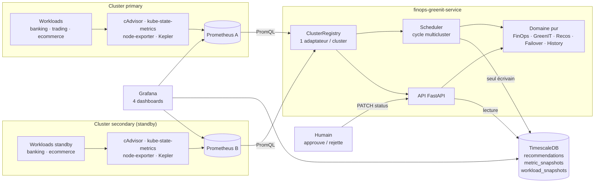
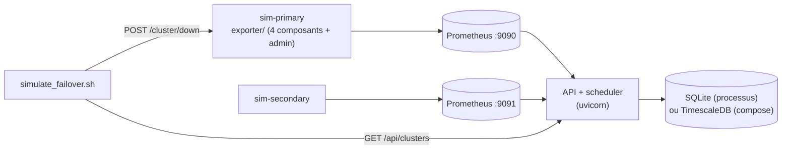

# Diagramme 1 — Architecture globale (V1)

> Retour : [ARCHITECTURE](../ARCHITECTURE.md) · [MULTICLUSTER](../MULTICLUSTER.md)

## 1.a Cible : plusieurs clusters, un Prometheus par cluster

Le service **observe** et **décide**. Aucune flèche ne va du service vers les clusters : il ne modifie rien.

## 1.b Démo locale (simulation)

