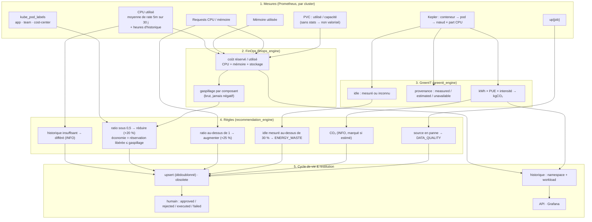

# Diagramme 4 — Flux métier FinOps / GreenIT (V1)

> Retour : [FINOPS](../FINOPS.md) · [GREENIT](../GREENIT.md)

Hors flux (V1) : actions automatiques, CO₂ par workload, CO₂ évité par un right-sizing, ML (V3), agent (V4).
